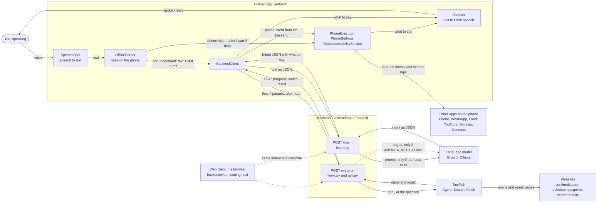

# Diplo architecture

How the parts of Diplo fit together, for someone reading the code for the first time. Everything
here was checked against the code in this repo. Where [README.md](../README.md) or
[PLAN.md](PLAN.md) say something the code doesn't do, the section
[Where the docs and the code differ](#where-the-docs-and-the-code-differ) says so.

## Overview

Diplo is a voice helper. You speak a request in Hindi, Hinglish or English. The **Android app**
turns your speech into text and first tries to understand it on the phone itself. Phone jobs
like calling someone or setting an alarm are understood and done right there, even without
internet. Anything the phone doesn't understand goes to the **backend**, a small Python server
that runs on a laptop. The backend uses simple rules and, if one is set up, a **language model**
(Groq in the cloud, or Ollama on the laptop) to work out what you want. Web jobs, like checking a
train ticket's PNR status, are done by **TinyFish**, a service that drives a real web browser.
Before anything risky, Diplo asks "haan?" and waits for your yes. Every answer is spoken back,
in Hindi for Hindi or Hinglish.

**What's here and what's coming next.** The frontend hasn't been added to the repo yet. It
brings the app's screens (`ui/`, `MainActivity.kt`), the code that runs the conversation step
by step (`AgentController.kt`, which the comments in `PhoneExecutor.kt` refer to) and the web
client (`backend/web/index.html`). Until then the Android app can't be built. This document
describes the building blocks that are in the repo, and marks what the frontend will add.

## Diagram



Dotted arrows happen only sometimes, or belong to the frontend that's coming next. The diagram
leaves out `AgentController.kt`, the frontend code that will call these parts in the right order.

## The parts

Kotlin paths are under `android/app/src/main/java/com/dietcode/diplo/`.

| Part | Folder | Main files | Job | Tech |
|---|---|---|---|---|
| Voice in and out | `voice/` | [SpeechInput.kt](../android/app/src/main/java/com/dietcode/diplo/voice/SpeechInput.kt), [Speaker.kt](../android/app/src/main/java/com/dietcode/diplo/voice/Speaker.kt) | Turn speech into text (Hindi, Hinglish, English) and speak replies | Android `SpeechRecognizer` (hi-IN), Android `TextToSpeech` |
| Understanding on the phone | `intent/` | [OfflineParser.kt](../android/app/src/main/java/com/dietcode/diplo/intent/OfflineParser.kt), [AgentIntent.kt](../android/app/src/main/java/com/dietcode/diplo/intent/AgentIntent.kt) | Turn text into an intent with no internet; tell "haan" from "nahi"; spot "ruko" | Kotlin rules (regular expressions) for Devanagari and Latin |
| Talking to the backend | `net/` | [BackendClient.kt](../android/app/src/main/java/com/dietcode/diplo/net/BackendClient.kt) | Send text to `/intent`; start `/web/run` and read its events | OkHttp, okhttp-sse, JSON |
| Doing things on the phone | `exec/` | [PhoneExecutor.kt](../android/app/src/main/java/com/dietcode/diplo/exec/PhoneExecutor.kt), [PhoneSettings.kt](../android/app/src/main/java/com/dietcode/diplo/exec/PhoneSettings.kt), [ContactNames.kt](../android/app/src/main/java/com/dietcode/diplo/exec/ContactNames.kt), [AppNames.kt](../android/app/src/main/java/com/dietcode/diplo/exec/AppNames.kt), [DiploAccessibilityService.kt](../android/app/src/main/java/com/dietcode/diplo/exec/DiploAccessibilityService.kt) | Call, WhatsApp/SMS, alarm, open and play in apps, phone settings, save and delete contacts, read the screen, tap WhatsApp's Send | Android Intents, Contacts provider, Settings, AccessibilityService |
| Screens and conversation (coming next) | `ui/`, `MainActivity.kt`, `AgentController.kt` | not in the repo yet | Mic button, transcript, Haan/Nahi, Stop; call the parts above in order | Jetpack Compose (already listed in [build.gradle.kts](../android/app/build.gradle.kts)) |
| Backend API | `backend/app/` | [main.py](../backend/app/main.py), [schemas.py](../backend/app/schemas.py) | The endpoints `/intent`, `/web/run`, `/health`, `/flows`; turn TinyFish events into the app's events; cancel runs | Python, FastAPI, pydantic, uvicorn |
| Understanding on the backend | `backend/app/` | [intent.py](../backend/app/intent.py), [llm.py](../backend/app/llm.py) | Rules for web flows and questions, the language model as a fallback, and the safety policy | httpx, any OpenAI-compatible chat API |
| Web tasks | `backend/app/` | [flows.py](../backend/app/flows.py), [tinyfish.py](../backend/app/tinyfish.py) | One goal per portal task (PNR status, scholarship status), run by the TinyFish Agent | TinyFish Agent (billed per step) |
| Web questions | `backend/app/` | [ask.py](../backend/app/ask.py) | Answer a question by quoting a live web page | TinyFish Search and Fetch (free) |
| Settings | `backend/` | [config.py](../backend/app/config.py), [.env.example](../backend/.env.example) | Read keys and switches from `.env` | python-dotenv |
| Web client (coming next) | `backend/web/` | only [README.md](../backend/web/README.md) for now | The same voice loop in a phone or laptop browser, served at `/` | HTML and JavaScript |
| Tests | `backend/tests/`, `android/app/src/test/` | [test_backend.py](../backend/tests/test_backend.py), `OfflineParserTest.kt`, `ContactNamesTest.kt`, `AppNamesTest.kt` | Check the parsers, policy, flows and streams | pytest, JUnit |
| Language model (outside) | — | — | Understand sentences the rules miss; small talk | Groq `openai/gpt-oss-120b` or Ollama `llama3.2:3b` |
| TinyFish (outside) | — | — | Drive a real browser on a portal; search and read pages | `agent.tinyfish.ai`, `api.search.tinyfish.ai`, `api.fetch.tinyfish.ai` |

## The life of a request

Two real examples, followed through the code. The frontend's `AgentController.kt` will run
these steps in this order; every function it calls is already in the repo.

### a) "Mummy ko call karo": understood on the phone itself

1. **Listen.** `SpeechInput.listen("hi-IN")` in `voice/SpeechInput.kt` starts Android's speech
   recognizer and asks for offline recognition first (`EXTRA_PREFER_OFFLINE`). When you stop
   talking, `onResults` passes on the text: `Mummy ko call karo`, or in Devanagari
   `मम्मी को कॉल करो`. If the phone has no offline Hindi pack, `onError` switches to the online
   recognizer and listens again.
2. **Understand it on the phone.** `OfflineParser.parse(text)` in `intent/OfflineParser.kt`
   lowercases the text, turns Devanagari digits into 0–9, and tries its rules in order: read the
   screen, send a message (`parseMessage`), save or delete a contact (`parseContactEdit`), play
   inside an app, open an app, change a setting (`parseSetting`), set an alarm, and last, call.
   "call karo" is not a message verb, so `parseMessage` gives up. The test `callIsNotAMessage`
   in `OfflineParserTest.kt` checks exactly this sentence. `callWords` finds "call", and
   `callTarget` takes the words before "ko" as the name. The result is an `AgentIntent` with
   `kind = PHONE`, `action = "call"`, `params = {contact: "mummy"}`,
   `needsConfirmation = true` and `speak = "Mummy को कॉल करूं?"`.
3. **Find the contact.** `PhoneExecutor.findContact("mummy")` in `exec/PhoneExecutor.kt`.
   "mummy" is in a group of relation words (मम्मी, माँ, mom, maa, mother, ...), so it looks for a
   contact saved under any of them. For other names, `ContactNames.extraWords` compares rough
   sound keys, so a spoken "राहुल" finds a contact saved as "Rahul". A comment in
   `PhoneExecutor.execute` says the controller does this before asking, so the question can name
   the contact that will really be called.
4. **Ask first.** `needsConfirmation` is true, so the app speaks the question with
   `Speaker.say(speak, onDone = { listen again })` in `voice/Speaker.kt`. It hears the answer
   with `SpeechInput` and checks it with `OfflineParser.confirmation(answer)`. That returns
   `true` for haan, हाँ, yes, ok; `false` for nahi, मत, cancel, ruko; and `null` (ask again) if
   it's unclear. It checks "no" first, so "nahi haan" counts as a no.
5. **Do it.** `PhoneExecutor.execute(intent)` calls `call(contact)`. With the phone permission
   granted, it starts `ACTION_CALL`, which dials at once. Without it, `ACTION_DIAL` opens the
   dialer with the number filled in. It returns the sentence to say:
   "Mummy को कॉल कर रहा हूं।"
6. **Say the result.** `Speaker.say(...)` speaks it.

No internet is used at any step. The call itself goes over the mobile network, and the backend
is never contacted. If the phone hadn't understood the sentence, the backend couldn't have
either without a language model: sending "Mummy ko call karo" to `POST /intent` with no model
set up returns `kind: "unknown"`, because the backend's rules only cover web flows and
questions. That's why phone commands are parsed on the phone.

### b) "PNR 1234567890 ka status batao": goes to the backend, then TinyFish

1. **Listen.** The same as in example a.
2. **The phone doesn't understand it.** `OfflineParser.parse` finds no rule: there's no "ko"
   for a message or call, and no call, alarm, app or setting words. It returns `null`.
3. **Ask the backend.** `BackendClient.parseIntent(text, history)` in `net/BackendClient.kt`
   sends `POST /intent` with `{"text": "...", "history": [{"user": "...", "diplo": "..."}]}`.
   `history` holds up to 6 earlier exchanges, so the model can understand follow-ups.
4. **The endpoint.** `parse_intent` in `backend/app/main.py` calls `intent.parse(text, history)`
   in `backend/app/intent.py`, which tries `match_flow` first, then the language model
   (`llm_parse`), then the question rules (`match_rules`).
5. **Rules first.** `match_flow` finds "pnr" in its keyword list. The list also holds "पीएनआर"
   and "ticket status", because the recognizer often mangles "PNR". `_digits` collects the
   digits, and because there are exactly 10, `_web_intent("pnr_status", {"pnr": "1234567890"})`
   builds a `web_task` intent that uses the flow's own question, "पीएनआर 1234567890 का स्टेटस देखूं?".
   With a missing or wrong-length number, it would return `kind: "clarify"` and ask
   "अपना दस अंकों का पीएनआर नंबर बोलिए।" instead. A rule matched, so the language model isn't
   called at all.
6. **Safety policy.** `apply_policy` sees `web_task` in `SENSITIVE_ACTIONS` and sets
   `needs_confirmation: true`. Running the backend gives exactly this reply:

   ```json
   {"kind": "web", "action": "web_task", "params": {"flow": "pnr_status", "pnr": "1234567890"},
    "needs_confirmation": true, "speak": "पीएनआर 1234567890 का स्टेटस देखूं?"}
   ```

7. **Ask first.** The app asks and waits for "haan", as in example a, step 4.
8. **Start the web task.** `BackendClient.runWebTask("pnr_status", {"pnr": "1234567890"}, onUpdate)`
   sends `POST /web/run` and keeps the connection open to receive events.
9. **Check the request.** `run_web` in `main.py` answers 404 for an unknown flow and 422 for
   missing params. Otherwise it starts the stream `_run_flow`.
10. **Write the goal and start TinyFish.** `flow.render_goal(params)` puts the PNR into the
    step-by-step goal in `backend/app/flows.py`: close pop-ups, type the PNR, read the status,
    don't log in or book anything, and never invent values. If `config.mocked("pnr_status")` is
    true, `_mock_run` sends canned events instead. Otherwise `TinyFish.stream_run` in
    `backend/app/tinyfish.py` posts the goal and `PNR_PORTAL_URL` (confirmtkt.com) to
    `https://agent.tinyfish.ai/v1/automation/run-sse`.
11. **Pass on the steps.** TinyFish opens the site in a real browser and works through the goal.
    `_run_flow` turns its events into the app's four kinds: `PROGRESS` becomes `progress`,
    `STREAMING_URL` becomes `watch` (a live view of the browser), `COMPLETE` becomes `result`
    or `error` through `_outcome`, and `HEARTBEAT` becomes an SSE comment that keeps the
    connection alive. If the connection to TinyFish drops after the run started, `_poll_run`
    asks `TinyFish.get_run(run_id)` every 3 seconds until the run is done.
12. **Make the spoken answer.** `flow.summarize(result)` (`_say_status` in `flows.py`) writes the
    sentence: "आपकी टिकट का स्टेटस है: CNF B2 34. 12951 Mumbai Rajdhani, 24 Oct, chart not
    prepared". If the site says the PNR is invalid, flushed or not found, it says
    "यह पीएनआर नंबर नहीं मिला। ..." instead, and if the site wants an OTP or captcha, it says
    "पोर्टल को और जानकारी चाहिए: ...".
13. **Back on the phone.** `WebEvent.fromJson` in `BackendClient.kt` turns each event into
    `Progress`, `Watch`, `Result` or `Error`. The frontend will show the steps, and the app
    speaks the result's `speak` with `Speaker.say`.

With `MOCK_TINYFISH=1` the stream looks like this (checked by running the backend):

```
data: {"type": "progress", "message": "Opening the portal"}
data: {"type": "progress", "message": "Filling in the details"}
data: {"type": "progress", "message": "Reading the result"}
data: {"type": "result", "data": {"status": "CNF B2 34", "details": "12951 Mumbai Rajdhani, 24 Oct, chart not prepared", "needs_user_input": ""}, "speak": "आपकी टिकट का स्टेटस है: CNF B2 34. 12951 Mumbai Rajdhani, 24 Oct, chart not prepared"}
```

This example needs a connection to the backend, and internet for TinyFish. A live PNR check
is billed: about 6 steps, about $0.10, according to `.env.example`.

## Safety

### Where it's decided that Diplo must ask "haan?" first

- **On the backend:** `apply_policy` in `intent.py`. Any intent whose action is in
  `SENSITIVE_ACTIONS` (`call`, `send_message`, `save_contact`, `delete_contact`, `web_task`)
  gets `needs_confirmation = True`. Its docstring says it plainly: "The model never decides
  whether to ask first; this does." Even if the language model leaves the flag out, the code
  sets it.
- **On the phone:** `OfflineParser` sets `needsConfirmation = true` itself for the same four
  phone actions.
- **No question asked** for `set_alarm`, `read_screen`, `open_app` and `set_setting`, which are
  quick to undo, or for `web_search`, which only reads public pages through the free TinyFish
  Search and Fetch.
- **Who actually waits for the yes:** the app. `docs/API_CONTRACT.md` says the app asks for
  phone actions whatever the backend replies. That waiting is done by `AgentController.kt`,
  which comes with the frontend. `/web/run` itself doesn't check for a "haan": anyone who can
  reach the backend can start a run. That's why the README says to keep `MOCK_TINYFISH=1` while
  a public tunnel is open.
- **Inside a web task:** every portal goal ends with `_SAFETY` in `flows.py`. It tells TinyFish
  never to invent values, and to stop and report `needs_user_input` at an OTP, a captcha it
  can't solve, a password or a payment.
- **Reading the screen:** `DiploAccessibilityService.readScreen` skips password fields
  (`isPassword`), so they are never read aloud.

### How "ruko" stops a running web task

1. `OfflineParser.isStop(text)` decides whether you said stop. "stop", "ruko" and "रुको" count
   anywhere in the sentence. "band karo" and "बंद करो" only count on their own or with fillers
   like "अरे" or "डिप्लो", so "टॉर्च बंद करो" turns the torch off instead of stopping Diplo.
   The tests in `OfflineParserTest.kt` check both cases.
2. The app then stops everything it's doing: `Speaker.stop()`, `SpeechInput.cancel()`, and
   `cancel()` on the `EventSource` that `BackendClient.runWebTask` returned. The comment on
   `runWebTask` says: "cancel the returned source to stop".
3. Cancelling closes the connection to `/web/run`. On the backend, the `finally` block at the
   end of `_run_flow` notices the run started but didn't finish, and calls
   `TinyFish.cancel(run_id)`. Without that, TinyFish's browser would keep going and keep
   billing. The cancel call is shielded so it still runs while the request is being torn down.
   The heartbeats sent every few seconds are how the backend notices: writing to a closed
   connection fails.
4. While Diplo is waiting for a yes, "ruko" simply counts as "no" (`OfflineParser.confirmation`).

The code that calls `isStop` and these stop functions is `AgentController.kt`, which comes with
the frontend.

### Why WhatsApp Send is only tapped while WhatsApp is on screen

`PhoneExecutor.sendMessage` opens the chat with
`https://api.whatsapp.com/send?phone=<number>&text=<message>`, so the message is already typed
in. The user has already said "haan", so `tapWhatsAppSend` then taps Send. It waits 1.2 seconds
for WhatsApp to open, then tries every half second, up to 17 times (about 9 seconds). Before each
tap it checks `DiploAccessibilityService.activePackage() == "com.whatsapp"`, and only then taps
the button with id `com.whatsapp:id/send`, or else the one labelled "Send".

The accessibility service can tap any app. If WhatsApp is slow to open, or you switch to another
app, a "Send" button in that other app could be tapped by mistake, and that's a message you
never said "haan" to. Checking which app is in front makes sure the tap lands only in WhatsApp,
on the message you approved. If the accessibility service is off, nothing is tapped. The chat
stays open with the text typed in, and you send it yourself.

Two details: the reply "... को व्हाट्सएप पर मैसेज भेज रहा हूं।" says "sending", not "sent",
because it's spoken before the tap is confirmed. For SMS, the app only opens the SMS app with
the text filled in (a `TODO` in the code), and says "मैसेज लिख दिया है।" ("I've written the
message").

### Why chat replies may never claim an action was done

If Diplo said "मैसेज भेज दिया" ("message sent") when nothing was sent, you would rely on
something that never happened. Four things in `intent.py` guard against this:

- The language model's instructions (`_SYSTEM_PROMPT`) say: "A chat reply never says you did or
  are doing something (sending, calling, opening): only an action does that. If the user wants
  something done, return that action instead."
- `apply_policy` rebuilds every chat reply as `Intent(kind="chat", speak=...)`, dropping any
  action and params, so a chat reply can never make the phone do something.
- For phone actions, `apply_policy` replaces the model's sentence with fixed wording from
  `_DEFAULT_SPEAK`, such as "{contact} को यह मैसेज भेजूं: {message}?". The code comment says why:
  the model's own wording "says 'संदेश भेज दिया' before the user has said haan".
- A phone action the app doesn't have (small models invent some) becomes `unknown`, with the
  reply "यह मैं अभी नहीं कर सकता। ...".

One limit: whether the words of a chat reply claim an action depends on the model following its
instructions. No code checks the chat text itself.

## Offline vs online

| Feature | No internet | Needs |
|---|---|---|
| Speech to text | yes, with the Hindi offline speech pack | otherwise Google's online recognizer, chosen automatically |
| Understanding phone commands (`OfflineParser`) | yes | — |
| Call | yes | the mobile network |
| Alarm, read the screen, open an app | yes | — |
| Brightness, volume, torch, Do Not Disturb, silent, text size | yes | permissions granted once, see `PhoneSettings.kt` |
| Wi-Fi, Bluetooth, mobile data, location | opens that settings page | Android 10+ doesn't let apps switch these |
| Save or delete a contact | yes | contacts permission |
| Play a song inside YouTube, YouTube Music or Spotify | the app opens | internet to play |
| Text to speech | yes, with a Hindi voice on the phone | — |
| SMS | the SMS app opens | the mobile network to send |
| WhatsApp message | — | internet |
| Sentences the phone doesn't understand | — | a connection to the backend; USB with `adb reverse` works without Wi-Fi |
| Backend rules (portal flows, question words) | yes, on the laptop | — |
| Language model | Ollama runs on the laptop | Groq needs internet |
| PNR and scholarship status | only with `MOCK_TINYFISH=1` (canned) | internet and TinyFish credits |
| Web questions | only canned "sample" answers without a key | internet and a TinyFish key (Search and Fetch are free) |

## Settings and secrets

The backend reads its settings from `backend/.env` through `config.py`. You make that file by
copying [backend/.env.example](../backend/.env.example):

| Setting | What it does |
|---|---|
| `TINYFISH_API_KEY` | Your TinyFish key. Without it, web questions get a canned sample answer (`MOCK_SEARCH`), and portal runs are fake unless `MOCK_TINYFISH=0`. |
| `MOCK_TINYFISH` | Fake portal runs, because real ones are billed per step. `1` = all fake, `0` = all real, or a comma list of flow ids to keep fake, e.g. `scholarship_status` (the NSP portal needs a login and an OTP). If it's not set, the code fakes them only when there is no key. |
| `LLM_BASE_URL` | Address of any OpenAI-compatible chat API: Ollama (`http://localhost:11434/v1`), Gemini, or Groq (`https://api.groq.com/openai/v1`). Empty turns the language model off: the backend then uses its rules only, so small talk gets "समझ नहीं पाया", or a web search if it has a question word ("नमस्ते कैसे हो"). With no `.env` at all it's empty, so the model is off. |
| `LLM_MODEL` | Which model to use. Default `llama3.2:3b`; with Groq, `openai/gpt-oss-120b`. |
| `LLM_API_KEY` | Sent as `Authorization: Bearer <key>`. Ollama ignores it; Groq needs a real key from console.groq.com. |
| `LLM_REASONING_EFFORT` | Only for reasoning models like gpt-oss: `low`, `medium` or `high`. `low` keeps replies to about 1 second. Empty = not sent. |
| `ANSWER_WITH_LLM` | `0` (default): a web answer is the best search snippet, completed from its page, so nothing is made up. `1`: the model writes the answer from the top two pages. Off by default because `llama3.2:3b` invented facts in testing. |
| `SCHOLARSHIP_PORTAL_URL` | Where the scholarship flow starts. Default `https://scholarships.gov.in/`. |
| `PNR_PORTAL_URL` | Where the PNR flow starts. Default `https://www.confirmtkt.com/pnr-status`, because indianrail.gov.in puts a captcha on PNR enquiry. |

The Android app has one setting of its own: `diplo.backendUrl` in `android/local.properties`,
the backend's address. Without it, the app uses `http://10.0.2.2:8000`, which is how the Android
emulator reaches the laptop. `local.properties` isn't committed either.

**Why `.env` is never committed.** `.env` holds real keys. Anyone with your TinyFish key can run
billed browser tasks on your account, and anyone with your Groq key can use your quota. Git keeps
every version of every file forever, so a key that was committed once stays in the history even
after the file is deleted, and bots scan GitHub for leaked keys within minutes. That's why
[.gitignore](../.gitignore) lists `.env`, and why `.env.example` only has empty placeholders.

## Where the docs and the code differ

| The docs say | The code does |
|---|---|
| README: `http://localhost:8000` opens the web client. | `GET /` returns 404 for now: `backend/web` only has a README. The web client comes with the frontend. |
| README: run the tests with `python -m pytest`. | `test_web_client_is_served` fails until the web client is added; run the tests with `--deselect tests/test_backend.py::test_web_client_is_served`. |
| README: android is a "Kotlin + Jetpack Compose app". | The Compose libraries are listed, but there are no screens yet. `AndroidManifest.xml` points at `MainActivity`, `Theme.Diplo` and strings that aren't in the repo, so the app can't be built yet. |
| PLAN: the LLM fallback is "Ollama locally / Gemini". | Any OpenAI-compatible API works. `.env.example` says the demo uses Groq (`openai/gpt-oss-120b`). |
| The chunk 7 commit: Groq "writes web answers". | Only with `ANSWER_WITH_LLM=1`. By default the answer is quoted from the page. |
| PLAN: confirmation is "enforced in `backend/app/intent.py` (`apply_policy`) and in the app". | `apply_policy` only sets `needs_confirmation`; the asking happens in the app's controller, which isn't in the repo yet. `/web/run` doesn't check for a yes. |
| PLAN: "Ruko or the Stop button cancels speech, listening and the web run immediately". | All the parts exist (see [Safety](#safety)), but the code that calls them on "ruko" comes with the frontend. |
| PLAN: a `mock-portal/` folder for a reliable scholarship demo. | There's no such folder. The scholarship flow points at `scholarships.gov.in` or is faked with `MOCK_TINYFISH`. |
| PLAN: the OTP pattern (two runs sharing a browser session). | Not built. A run that hits an OTP reports `needs_user_input`, and Diplo says "पोर्टल को और जानकारी चाहिए: ...". |
| PLAN: logins go through TinyFish Vault. | Nothing uses Vault. `stream_run` could pass `use_vault`, but no flow does. |
| PLAN: payments are handed to the user's UPI app. | Nothing in the code handles payments; the flows tell TinyFish to stop at a payment. |
| PLAN: start listening from any app with the accessibility button. | Still a `TODO` in `DiploAccessibilityService.kt`. The config asks for the button, but no code reacts to it. |
| `schemas.py` comment: phone actions are `call`, `send_message`, `set_alarm`, `read_screen`. | The code handles eight phone actions, also `open_app`, `set_setting`, `save_contact` and `delete_contact` (as in `API_CONTRACT.md`). |

## Glossary

- **API:** the set of requests one program accepts from another, and the replies it gives. The
  backend's API is `/intent`, `/web/run`, `/health` and `/flows`.
- **Endpoint:** one address in an API that does one job, such as `POST /intent`.
- **JSON:** a text format for data as names and values, like `{"kind": "web", "pnr": "1234567890"}`.
  The app and the backend send each other JSON.
- **SSE (Server-Sent Events):** a way for a server to keep a connection open and send many small
  messages, one after another, each on a line starting with `data:`. Diplo uses it so the steps
  appear while TinyFish works, instead of only at the end.
- **LLM (large language model):** a program trained on a huge amount of text that can read a
  sentence and write a reply. Diplo uses one (Groq or Ollama) to understand sentences its rules
  miss, and for small talk.
- **Fallback:** a plan B used when plan A doesn't work. The backend is the fallback when the
  phone's rules miss; the LLM is the fallback when the backend's rules miss; the online
  recognizer is the fallback when there's no offline Hindi pack; polling is the fallback when the
  TinyFish stream drops.
- **Mock:** a fake stand-in that gives canned answers, so you can build and test without paying
  or without a key. `MOCK_TINYFISH=1` turns on the mock portal runs.
- **Intent:** what the user wants, written down as data: `kind` (phone, web, chat, clarify,
  unknown), `action` (such as `call`), `params` (such as the contact), `needs_confirmation` and
  `speak` (what to say next). `AgentIntent` in Kotlin and `Intent` in Python are the same thing
  on the two sides.
